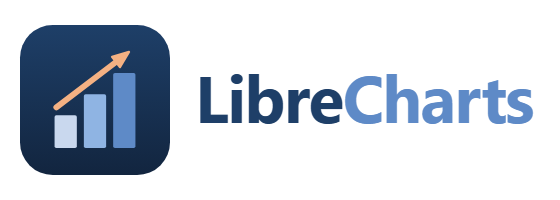

<p align="center">
  
</p>

# LibreCharts

think-cell-style charts for **LibreOffice Impress**, as an open-source extension.
Charts are drawn as native shapes and fed from a Calc data sheet.

> **Status: M1 to M30 done; M21 languages done, macOS CI pending.** Stacked, clustered and 100 % **column and bar charts**,
> **line, stacked and 100 % area charts**, **pie, doughnut, scatter, bubble and butterfly
> charts**, **waterfall**, **Marimekko** and **Gantt charts** work: edit the
> data in a Calc window (formulas included), resize charts freely, undo everything, save as ODP or
> PPTX. Column charts can draw single series as **lines on a secondary axis**.
> Column, bar and waterfall charts take **difference arrows, CAGR arrows and axis breaks**; column
> and bar charts switch their variant and sort their categories. Charts can show a **value axis**
> with gridlines, a **number format** per chart, **series labels or a legend** and **value lines**.
> A **colour scheme** styles the whole deck, single series can take another palette colour, charts
> can share a **same scale** across slides, and a **chart format** can be copied to other charts.
> A chart can take its data from a **linked Calc or Excel file** and be updated in one step.
> Value labels and totals can be **moved by hand** and stay where you put them.
> Annotations work on every chart type, including **category gaps and group brackets**; column,
> bar and waterfall charts also take **floating bars**, **error bars** and **stacked or horizontal
> waterfalls**. Labels are **rounded so they add up** and **move apart when they overlap**.
> Gantt charts support **several bars per row**, **working-day calendars** and **import from CSV or
> ProjectLibre**.
> Beyond charts: **Harvey balls**, **check marks**, **arranging shapes** (same size, grid, swap)
> and an **agenda** with a highlighted divider slide before every chapter.
> Decks can be **built from templates**, **checked against a corporate design** and fixed in one
> step; charts carry **alternative text**, can show **patterns** beside their colours and export
> their data as **CSV**. The UI speaks English, German, French, Spanish and Italian.
> **6.0** adds single-label overrides and a **focus mode**, a **source line** and callouts, a
> per-chart font size and legend position, **manual axes and axis titles**, a **logarithmic axis**
> and **trendlines with forecasts**, **dumbbell, bullet, Pareto, funnel and box plot** charts,
> **tables and 2x2 matrices**, **distribute/align** commands, **process, chevron and pyramid
> graphics**, an **icon set** and **chart templates**. **7.0** adds **CSV/ODS/XLSX import**, charts
> from the clipboard, auto-updating links, a **deck audit with jump-to-slide**, deck-specification
> export, batch format and data operations, a **palette and font dialog**, a **colour-blindness
> simulation**, alternative text for every element and design checks over master slides.
> Further work is listed in [ROADMAP.md](ROADMAP.md).
> LibreCharts is inspired by think-cell and empower charts but is not affiliated with them and
> does not read or write their files.

## Requirements

- LibreOffice **25.8 or newer** (Windows and Linux tested; macOS supported, CI tests to follow).
  The minimum is enforced by the package.
- UI languages: English, German, French, Spanish and Italian; any other UI language shows English.
  Translations are welcome: [docs/translating.md](docs/translating.md).

## Install

1. Build the package (see below) or take `LibreCharts-<version>.oxt` from a
   [release](https://github.com/AndyPischka/LibreCharts/releases).
2. In LibreOffice: *Tools → Extension Manager → Add…* and pick the `.oxt`; restart LibreOffice.
3. In Impress, use the **LibreCharts** menu or toolbar to insert a column, bar, line, area,
   pie, scatter, butterfly, waterfall, Marimekko or Gantt chart; double-click a chart (or select it and choose *Edit chart data*)
   to change its data in Calc. The **LibreCharts** deck in the sidebar (icon with the difference
   arrow; *View → Sidebar*) offers the same commands, shows the selected chart and lists its
   annotations; the **LibreCharts Presentation** deck (align icon) holds elements, arrange, agenda
   and document commands.
   A Marimekko chart can be switched between percent (every column 100 % high) and units (column
   heights follow their sums) from its context menu or the sidebar. Column and bar charts switch
   between stacked, clustered and 100 % the same way, and sort their categories by value; area
   charts switch between stacked and 100 %. A column chart can draw single series as lines and put
   them on a secondary axis (*Series as lines*).
   The chart's context menu and the sidebar have a *Format* section: show or hide the value axis and
   gridlines, switch between series labels, a legend or no names, hide the point markers of a line,
   and set the number format. *Add value line...* draws a target, the average or the median across
   the plot. A line chart can *Interpolate missing values*: empty cells are bridged with a straight
   line instead of splitting the series (the bridged points get no marker and no label).
   The context menu's *Series colour* submenu gives a series another palette colour. The sidebar's
   *Document* section switches the document-wide colour scheme (*Default*, *Grey*, *High contrast*)
   or loads/saves a scheme file. Select several charts and choose *Use the same scale* to compare
   their values across slides; *Copy chart format* / *Apply chart format* transfer the look of one
   chart to others. *Show patterns* adds hatches and dashes beside the colours for colour-blind
   readers and black-and-white print; every chart carries alternative text generated from its
   data. *Export chart data as CSV...* writes a chart's data to a file, and *Check corporate
   design...* checks every slide against a corporate design file and fixes what deviates.
   A Gantt chart's data sheet has one row per activity (Activity, Start, End, Remark, Phase): two
   dates give a bar, one date a milestone, text in *Phase* makes a phase over the rows below it.
   Further start/end pairs in F/G, H/I, ... give the same row more bars. *Working days* hides
   weekends and holidays from the time scale. *Import* fills the data sheet from a CSV file or a
   ProjectLibre `.pod` / MS Project XML file.
   *Add date line...* and *Add today line* mark a date; the rows can be sorted by start date.
   *Link data...* takes a chart's data from a range (or named range) of a Calc, Excel or CSV
   file instead of its data sheet; *Update link* or *Update all links* reads the file again,
   *Open source* opens it. A presentation whose linked files changed says so in an info bar
   when it is opened. Keep deck and workbook in one folder to move them together.
4. To annotate a column, bar, line or waterfall chart, select it and choose *Add difference arrow*,
   *Add level difference* or *Add CAGR arrow* (menu, toolbar or the chart's context menu), then
   click the columns as the bar above the slide says; `Esc` cancels. *Add axis break* opens a
   dialog: automatic, or the lower and upper value to cut out of the whole axis. The context menu of
   the chart switches arrows between percent and absolute, or bracket and level, changes the axis
   break and removes annotations.

## Automate

A deck can be built from a **template** and a **deck specification**: one JSON file with a chart per
placeholder. A placeholder is any shape named `librecharts-placeholder:<key>`; the chart lands at its
position and size and the placeholder is removed. The template keeps its slides, master slides and
colour scheme.

```
uv run poe deck build --template template.odp --data charts.json --out deck.odp
uv run poe deck update deck.odp            # refresh every data link, save in place
uv run poe deck check deck.odp --design corporate.json [--fix]   # corporate design check
```

`poe deck` finds LibreOffice itself and runs headless; `--locale de` switches the messages, `--out`
lets `update` and `check --fix` write another file. `check` exits with code 3 when it found
deviations and did not fix them, so a build pipeline can stop there.

A corporate design file is a colour-scheme file with an optional `check` object:

```json
{"v": 1, "name": "Corporate", "palette": [13158, 16750848], "font_name": "Calibri",
 "check": {"colors": [43520], "fonts": ["Calibri Light"],
           "margins_mm": {"left": 12, "top": 10, "right": 12, "bottom": 10}}}
```

```json
{
  "version": 1,
  "charts": [
    {
      "placeholder": "revenue",
      "kind": "column",
      "data": [[null, "2023", "2024"], ["Product A", 10, 12], ["Product B", 20, 22]],
      "format": { "axis": true, "decimals": 0 }
    }
  ]
}
```

Every chart option works as a field: `grouping`, `percent`, `sort`, `doughnut`, `range`, `errors`,
`horizontal`, `stacked`, `lines`, `secondary`, `colors`, `format`, `calendar`, `interpolate`. A chart
without a placeholder stops the build before anything is written; a placeholder without a chart
stays and is reported. Annotations are added through the command
`org.librecharts:AddAnnotation?kind=value_line&mode=median` (the mode is `average` by default).

From a Python script inside LibreOffice, `librecharts.api` offers `build_deck(...)`,
`update_links(ctx, doc)`, `insert_chart(ctx, doc, slide, spec_json)` and
`check_design(doc, design_file, fix=False)`. A Basic macro dispatches
the command:

```basic
oDispatcher = createUnoService("com.sun.star.frame.DispatchHelper")
oDispatcher.executeDispatch(ThisComponent.getCurrentController().getFrame(), _
  "org.librecharts:BuildDeck?template=file:///…/template.odp&data=file:///…/charts.json" & _
  "&out=file:///…/deck.odp", "", 0, Array())
```

*Update all links* is the command `org.librecharts:UpdateAllLinks`;
`org.librecharts:CheckDesign?file=...&fix=true` checks and fixes a deck,
`org.librecharts:ExportCsv?url=...` writes the selected chart's data.

## Develop

Requires [uv](https://docs.astral.sh/uv/).

```
uv run poe setup    # dependencies + git hooks
uv run poe check    # lint, format, types, tests (what CI runs)
uv run poe build    # dist/LibreCharts-<version>.oxt
uv run poe deck     # build a deck from a template and a spec, update its links, check a design
uv run poe locales  # write the translation sources after changing a UI string
uv run poe test-lo  # integration tests against an installed LibreOffice
```

More: [CONTRIBUTING.md](CONTRIBUTING.md), [ARCHITECTURE.md](ARCHITECTURE.md), [AGENTS.md](AGENTS.md) (for AI agents).

## License

[MPL-2.0](LICENSE)
